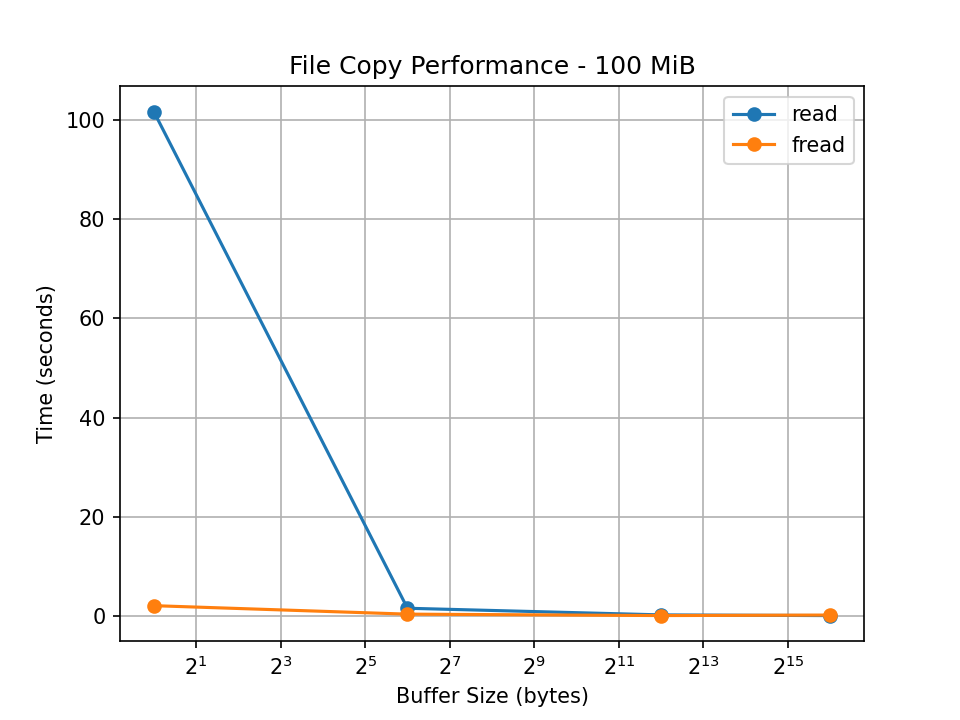

# Operating Systems — Task 2 (Level C)

## 1. Introduction

In this assignment, I compared different methods of copying files in C.

I used a 100 MiB test file and tested four buffer sizes: 1, 64, 4096, and 65536 bytes.

## 2. File Copy Methods

I implemented two main methods:

- `read()` and `write()` for copying files using Linux system calls.
- `fread()` and `fwrite()` for copying files using the standard C library.

I also implemented direct `syscall(SYS_write, ...)` and `sendfile()` for additional comparison.

## 3. Performance Results

The execution times were measured using a Python benchmarking script.

| Buffer size | read/write time | fread/fwrite time |
|---|---|---|
| 1 byte | Add result | Add result |
| 64 bytes | Add result | Add result |
| 4096 bytes | Add result | Add result |
| 65536 bytes | Add result | Add result |

## 4. System Call Analysis

I used `strace -c` to count system calls.

Small buffers require many operations when using read/write. Larger buffers reduce the number of system calls, which can improve performance.

The results demonstrate how system-call overhead affects file-copying speed.

## 5. Direct Syscall

I used `syscall(SYS_write, ...)` instead of the normal `write()` wrapper.

I verified the copied file using `cmp` and SHA-256 hashes.

The copied data was identical to the original data.

## 6. sendfile Comparison

I tested `sendfile()` as an additional copying method.

It can be more efficient because data can be copied inside the kernel without passing through a user-space buffer.

The measured time was: **[add your result]**.

Compared with read/write, sendfile was **[faster/slower/about the same]** in my experiment.

## 7. Conclusion

In this assignment, I learned how buffer size and system calls affect file copying.

I compared two C file-copying methods, measured their execution times, and created a graph.

I also used strace to investigate system calls, verified a direct write syscall, and tested sendfile.

The experiment helped me understand the difference between standard library functions and Linux system calls.
