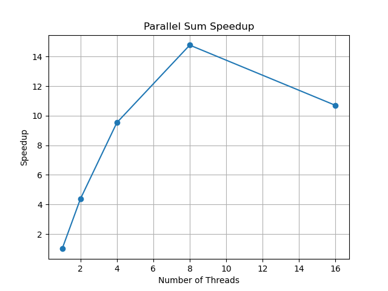
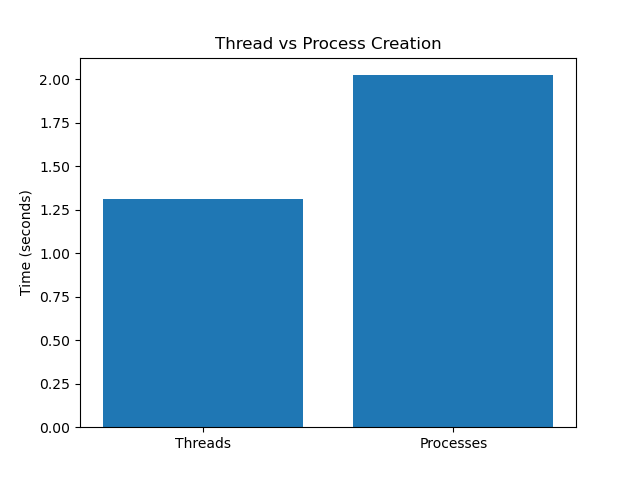
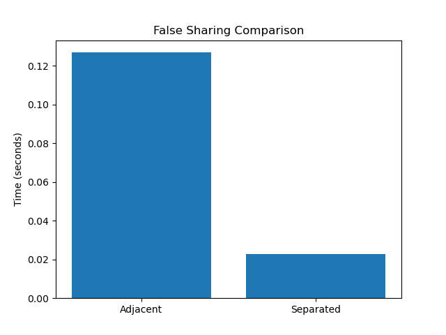

# Operating Systems — Task 4 (Level C)

## 1. Introduction

In this assignment, I studied multithreading and multiprocessing in Linux using C and pthreads.

I performed three experiments to compare their performance.

## 2. Parallel Array Sum

I created an array containing 100 million elements and calculated its sum using 1, 2, 4, 8, and 16 threads.

I measured execution time and calculated speedup for each number of threads.

Using more threads can improve performance because the work is divided between CPU cores. However, after a certain point, the improvement becomes smaller due to limited CPU cores, memory bandwidth, and thread overhead.

## 3. Thread vs Process Creation

I compared the time required to create and wait for 10,000 threads and 10,000 processes.

Threads share memory within a process, while processes have separate virtual address spaces.

Creating threads is often less expensive, but the actual results depend on the operating system and hardware.

## 4. False Sharing

I tested two threads updating adjacent memory locations and compared them with threads updating values separated by padding.

False sharing occurs when threads modify different variables that share the same CPU cache line.

This can reduce performance because the processors must repeatedly coordinate access to the cache line.

## 5. Results

### Parallel Sum

The measured results are stored in `sum_results.csv`.

The number of available CPU cores was: **[insert nproc result]**.

The highest measured speedup occurred with **[insert number]** threads.

### Thread and Process Creation

The results are stored in `creation_results.csv`.

The faster operation in my experiment was **[insert result]**.

### False Sharing

The results are stored in `sharing_results.csv`.

The faster configuration was **[insert result]**.

## 6. Additional: clone()

Linux uses `clone()` and related mechanisms to create tasks.

Threads usually share memory and other resources with their parent process, while ordinary processes have separate virtual address spaces.

The direct `clone()` experiment was not implemented because it was an optional requirement.

## 7. Conclusion

In this assignment, I learned how to use pthreads to perform calculations in parallel.

I compared the cost of creating threads and processes and investigated false sharing.

I also measured execution times and created graphs to compare the results.

These experiments helped me understand how CPU cores, memory, and thread management affect program performance.
