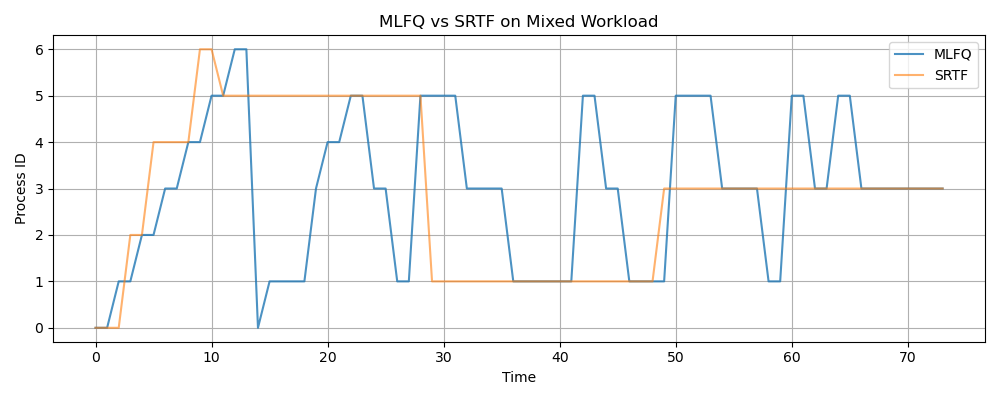
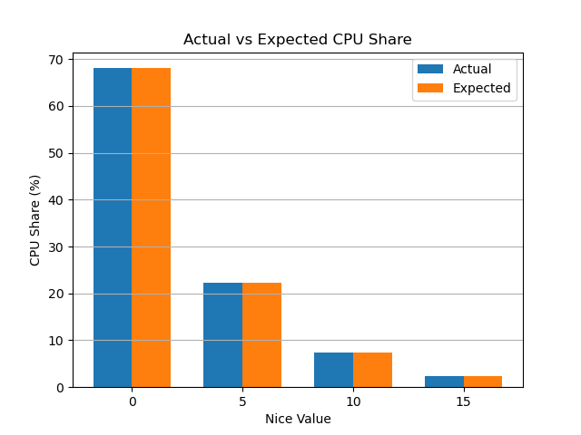

# Operating Systems — Task 5 (Level C)

## 1. Introduction

In this assignment, I studied CPU scheduling in Linux.

I implemented MLFQ scheduling and compared it with SRTF. I also tested different nice values and the SCHED_FIFO real-time scheduling policy.

## 2. MLFQ vs SRTF

I implemented MLFQ with three priority queues.

The time quantums were 2, 4, and 8 units.

When a process used its entire quantum, it was moved to a lower-priority queue. Every 20 time units, unfinished processes received a priority boost.

I compared MLFQ with SRTF using short and long CPU bursts.

MLFQ can behave similarly to SRTF because short tasks often finish in high-priority queues. However, SRTF knows the remaining execution time, while MLFQ does not.

## 3. Nice Values and CPU Scheduling

I ran four CPU-intensive processes with nice values of 0, 5, 10, and 15.

All processes competed for one CPU core.

| Nice | Actual CPU share | Expected share |
|---|---|---|
| 0 | 68.05% | 68.04% |
| 5 | 22.25% | 22.26% |
| 10 | 7.30% | 7.31% |
| 15 | 2.40% | 2.39% |

The measured CPU shares were very close to the expected scheduling weights.

## 4. SCHED_FIFO

I tested SCHED_FIFO using the chrt command.

Linux's real-time runtime limit was set to 950000 microseconds per second.

In the preliminary test, the normal process received 2.020 seconds of CPU time without a FIFO competitor and 1.794 seconds with the competitor.

This suggests reduced CPU availability, although further measurement is needed to confirm the competitor ran under FIFO throughout the test.

## 5. EEVDF vs CFS

Traditional CFS used virtual runtime to decide which normal process should run next.

EEVDF uses task eligibility and virtual deadlines to improve scheduling decisions while maintaining fairness.

My Ubuntu system uses Linux kernel 7.0.0-38-generic.

## 6. Conclusion

In this assignment, I learned how different CPU scheduling algorithms work.

I implemented MLFQ, compared it with SRTF, tested Linux nice values, and investigated SCHED_FIFO.

The results helped me understand how Linux distributes CPU time between processes and how scheduling priorities affect performance.
