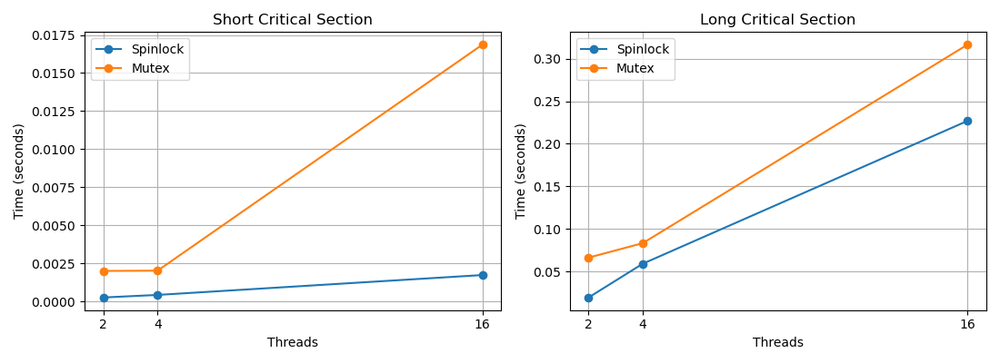

# Operating Systems — Task 6 (Level C)

## 1. Introduction

In this assignment, I studied synchronization between threads using C and pthreads.

I implemented a spinlock, compared it with a mutex, and investigated the readers–writers problem.

## 2. Spinlock vs Mutex

I implemented a custom spinlock using `__atomic_test_and_set`.

I compared it with `pthread_mutex_t` using 2, 4, and 16 threads.

I tested both short and long critical sections.

A spinlock can be faster for very short critical sections because it does not always need to put the waiting thread to sleep.

However, for longer critical sections, a mutex may perform better because a spinlock can waste CPU time while waiting.

The exact performance depends on the number of threads, CPU cores, and workload.

## 3. Readers–Writers Problem

I implemented two synchronization policies:

- Reader priority
- Writer-starvation-free priority

In the first version, new readers can continue accessing shared data while a writer waits. This can cause writer starvation.

In the second version, new readers must wait when a writer is already waiting.

The measured results are saved in the `evidence` folder.

## 4. Race Detection

I tested the synchronization programs using Helgrind and ThreadSanitizer.

Helgrind was used to investigate possible race conditions and synchronization problems.

ThreadSanitizer was also used to check the implementation using atomic operations.

**Results:** [Insert the actual diagnostic findings.]

## 5. Conclusion

In this assignment, I learned how spinlocks and mutexes work.

I compared their performance using different numbers of threads and critical-section lengths.

I also implemented two solutions to the readers–writers problem and studied how writer starvation can occur.

Finally, I used race-detection tools to check the synchronization code.
