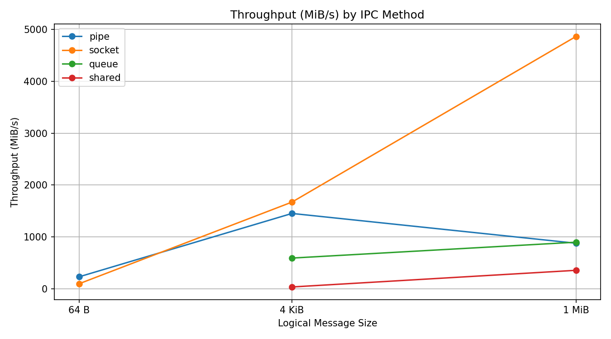
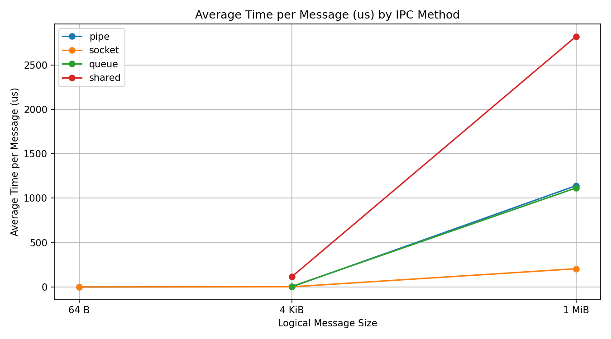

# Operating Systems — Task 7 (Level C)

## 1. Introduction

In this assignment, I studied how two Linux processes communicate using different IPC methods.

I implemented four methods in C: pipe, Unix domain socket, POSIX message queue, and shared memory with semaphores.

## 2. IPC Methods

I transferred 1 GiB of data between two processes using message sizes of 64 bytes, 4096 bytes, and 1 MiB.

For POSIX message queues, large logical messages were divided into smaller chunks because Linux limits the size of individual queue messages.

## 3. Performance Results

I measured transfer time, throughput, and average time per logical message.

The detailed results are saved in `ipc_results.csv`.

The fastest method in my measurements was **[insert method and message size]**.

The average transfer time per message is calculated from the total transfer time. It is not the same as direct one-way message latency.

## 4. System Call Analysis

I used `strace -f -c` to study system calls made by the programs.

Pipe and Unix socket communication use kernel operations to transfer data between processes.

POSIX message queues use kernel-managed messages.

Shared memory allows processes to access the same mapped memory without copying every message through a pipe or socket. Semaphores are used to synchronize access.

I also used `perf stat` to investigate CPU performance where counters were available.

## 5. SIGTERM Cleanup

I tested how the programs behave when interrupted using SIGTERM.

Both the message queue and shared memory programs stopped within five seconds and returned exit code 1 because their transfers were interrupted.

No new named IPC resources remained, and no matching benchmark processes were found afterward.

This shows that the cleanup tests passed under the conditions tested.

## 6. Message Latency

I measured pipe communication latency using 10,000 message exchanges between two processes.

The average round-trip latency was 45.495 microseconds, and the estimated one-way latency was 22.748 microseconds.

The results show that even small messages require time for communication and process synchronization.

This experiment measured pipe latency only. The other IPC methods were compared using throughput and average transfer time per logical message..

## 7. Conclusion

In this assignment, I learned how processes communicate in Linux.

I compared four IPC methods, measured their performance, and investigated system calls.

I also tested cleanup when programs receive SIGTERM.

The experiments showed that IPC performance depends on message size, data copying, kernel operations, and synchronization.
